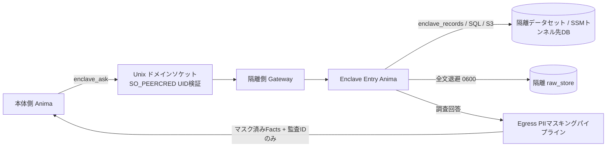

# AnimaWorks — Organization-as-Code

### LINEで話しかけるだけで、裏でソフトウェアを出荷し続けるAI組織。

AnimaWorksは、記憶・人格・役職・スケジュールを持つ永続的なAIエージェント（Digital Anima）を束ね、「生きた組織」として24時間稼働させるオープンソースフレームワークです。

人間が向き合う画面は、まるでお馴染みのメッセンジャーアプリ（LINE）のような親しみやすいトークルーム。
しかしその裏側では、独立したOSプロセスで動くエージェントたちがタスクを分解し、並列の `git worktree` でコードを書き、互いにテスト・マルチモデルレビューを回し、Pull Requestを作成してCIの失敗を自律修復し、デプロイ後のログ観測までを人間の手を借りずに完遂します。

```text
人間のひとこと / GitHubイベント / 定期スケジュール（Heartbeat・Cron）
   ↓
リーダーAnimaが分解・委譲（SQLite TaskStore・排他キー・委任契約）
   ↓
エンジニアAnimaが隔離worktreeで実装 → テスト → マルチモデルPRレビュー → CI修復 → デプロイ観測
   ↓
判断が必要な例外・承認だけを、LINE風チャットや音声通話・通知で人間へエスカレーション
```

AnimaWorksは「決められたビルドパイプライン」をハードコードしていません。フレームワークが提供するのは、**脳科学ベースの長期記憶・プロセス隔離・タスク基板・権限とPII隔離（Enclave）・通信網**という「組織のインフラ」です。だからこそ、同じ組織がコード出荷だけでなく、競合調査も、顧客対応も、議事録作成も、Slackや電話での連絡も自律的にこなします。ワークフローエンジンではなく、**組織そのもの**だからです。

**[English README](README.md)** | **[简体中文 README](README_zh.md)** | **[한국어 README](README_ko.md)**

---

## 本番環境での稼働実績

絵空事のデモではありません。過去6ヶ月間、8体のAnimaで構成されたAnimaWorks組織が、本番SaaSプロダクトの日常的な開発・運用・保守を実際に回し続けています。

| 指標（2026年3月〜8月・一次実行ログ集計） | 実績値 |
|---|---|
| エージェントが自ら作成した Pull Request | **302件**（うち **267件** マージ） |
| エージェントが運用した Pull Request（レビュー・CI修復・コンフリクト解消） | **752件**（うち **721件** マージ） |
| 組織が自発的に起票・実行したタスクの比率 | **99.7%**（全31,215タスク中、人間起点はわずか92件） |
| GitHubイベントから自動生成されたタスク数（8月単月） | **2,508件** |

<p align="center">
  
  <br><em>刷新されたLINE風チャットUI: 左のAnimaレールでメンバーの稼働状況を一望し、右下の常駐バストアップが表情を変えながら応答。顔アイコンをクリックすれば、記憶のつながり（エンティティ相関バブルチャート）がその場で吹き出し展開されます。</em>
</p>

<p align="center">
  
  <br><em>3D Workspace: 組織ツリー、各Animaのステータス、直近のアクションをリアルタイムに可視化。</em>
</p>

<p align="center">
  
  <br><em>ドット絵オフィス（Pixel Workspace）は単なる演出ではありません。吹き出しの一つひとつが、今この瞬間に裏で走っている実タスクです。</em>
</p>

---

## :rocket: 60秒で体験する（デモ環境）

**Claude Code CLI が入っているか、Codex にログイン済みなら API キーすら不要です。**

ワンライナーでクローン＆セットアップし、3日分の活動履歴と3人のチーム（PM `kaito`・リードエンジニア `sora`・アシスタント `hina`）が入ったデモ組織をすぐ動かせます。本番の `~/.animaworks` とは完全に分離された専用ディレクトリ（`~/.animaworks-demo`）で動くため、環境を汚しません。

```bash
curl -sSL https://raw.githubusercontent.com/xuiltul/animaworks/main/scripts/setup.sh | bash
cd animaworks
uv run animaworks demo --preset ja-business
```

**http://localhost:18501** を開くだけで、すでに仕事を進めているチームとLINE風画面で会話を始められます（[デモの詳細はこちら →](demo/README.ja.md)）。

> **選べる4つのプリセット**: `ja-business`（日本語・リアル調）/ `ja-anime`（日本語・アニメ調）/ `en-business`（英語・既定）/ `en-anime`（英語・アニメ調）。プリセットを切り替える際は `--reset` を付けて再実行してください（例: `uv run animaworks demo --reset --preset ja-anime`）。

---

## クイックスタート（自分の組織を作る）

### macOS / Linux / WSL

```bash
curl -sSL https://raw.githubusercontent.com/xuiltul/animaworks/main/scripts/setup.sh | bash
cd animaworks
uv sync --all-extras        # Claude SDK / Codex 等の実行エンジンextraを一括導入
animaworks start            # サーバー起動（初回はブラウザでセットアップウィザードが開きます）
```

> **`setup.sh` がやること**: [uv](https://docs.astral.sh/uv/) の導入、リポジトリのクローン、Python 3.12+ と依存パッケージのインストール、そして `~/.local/bin/animaworks` へのシンボリックリンク作成まで自動で行います。以降はどのディレクトリにいても `animaworks` コマンドだけで操作できます。
>
> **重要**: `uv sync` を手動で叩くときは必ず `--all-extras` を付けてください。素の `uv sync` を実行すると `codex` / `claude` 等の実行パッケージが仮想環境から外れ、該当モードのAnimaが起動できなくなります。

### Windows (PowerShell)

```powershell
git clone https://github.com/xuiltul/animaworks.git
cd animaworks
uv sync --all-extras
uv run animaworks start
```

> OpenAI Codex を API キーなしで使う場合は、初回起動前に `codex login` を実行してください（なお Windows 環境では Mode S = Claude Agent SDK は非対応のため、Codex / Gemini / API モードをご利用ください）。

### 初回セットアップウィザード（5ステップ）

**http://localhost:18500/** を開くと、`.env` を1行も手書きすることなくブラウザ上で初期設定が完了します:

1. **言語選択** — ウィザードは17言語、ダッシュボード本体は `ja` / `en` / `ko` に対応
2. **オーナー作成** — 管理者アカウントの登録
3. **LLM認証 & アバター画風** — APIキーまたはサブスクリプション認証（Claude Code / Codex Login）と、リアル調 / アニメ調の選択
4. **最初のAnima作成** — リーダーとなる最初のメンバーに名前を付ける
5. **確認・起動** — 設定はすべて `config.json`（および暗号化Vault）へ安全に保存されます

<details>
<summary><strong>その他のインストール方法（スクリプト事前確認 / 手動uv / Docker / pip）</strong></summary>

#### スクリプトの中身を確認してから実行したい場合

```bash
curl -sSL https://raw.githubusercontent.com/xuiltul/animaworks/main/scripts/setup.sh -o setup.sh
cat setup.sh
bash setup.sh
```

#### uv で手動インストールする場合

```bash
curl -LsSf https://astral.sh/uv/install.sh | sh
export PATH="$HOME/.local/bin:$PATH"

git clone https://github.com/xuiltul/animaworks.git && cd animaworks
uv sync --all-extras
uv run animaworks start
```

#### Docker で動かす場合

```bash
git clone https://github.com/xuiltul/animaworks.git && cd animaworks
# .env に認証情報を設定（ANTHROPIC_API_KEY / CLAUDE_CODE_OAUTH_TOKEN / GH_TOKEN 等）
docker compose up -d --build
```

ブラウザウィザードを使わずにヘッドレスで初期化する例:

```bash
docker exec -it <container> animaworks init --skip-anima
docker exec -it <container> animaworks anima create --name alice --template dev-lead
docker exec -it <container> animaworks config set setup_complete true
docker exec -it <container> animaworks send <your-name> alice "こんにちは"
```

#### pip で手動インストールする場合（Python 3.12 / 3.13 推奨）

```bash
git clone https://github.com/xuiltul/animaworks.git && cd animaworks
python3 -m venv .venv && source .venv/bin/activate
pip install --upgrade pip && pip install -e ".[all-tools]"
animaworks start
```

</details>

---

## 表の顔：人間にとっては「LINE感覚で話せるチーム」

自律エージェントフレームワークの多くは、人間側に「大量のログ監視」や「複雑なノード編集画面」を強います。AnimaWorksのチャット画面は逆です。**普段の連絡はLINEのように軽快に、深掘りしたいときだけワンタップで記憶や裏作業を開く**設計になっています。

### 1. LINE風トーク画面・左Animaレール・右下常駐バストアップ
- **直感的な吹き出しトーク**: 人間の発言は右側のグリーンの吹き出し、Animaの応答は左側の白い吹き出しで表示。ストリーミング中も思考プレビューやツール実行状況が滑らかにアニメーションします。
- **左縦レール（Anima Rail）**: 画面左端にメンバーの顔アイコンが並び、誰が作業中（青リング）で、誰があなたの返事を待っているか（琥珀色の要返信バッジ）が一目で分かります。よく話すメンバーだけを残して `×` で畳んだり、`+` で戻したり、最大4ペインの画面分割や最大5名の**ミーティングモード（司会者付きグループ議論）**へもワンクリックで切り替えられます。
- **右下バストアップ常駐（Presence Panel）**: トーク画面の右下には、会話中のAnimaのバストアップが常駐。応答の感情（`smile` / `thinking` / `troubled` / `surprised` 等）に合わせてリアルタイムに表情を変え、作業中は「何をしているか」を小さな吹き出しでつぶやきます。

### 2. 人間中心のフィード整理と「ワンタップ承認・引用リプライ」
- **ノイズのない会話フィード**: 24時間動く組織では、裏で何百回ものHeartbeat巡回やAnima同士のDM、定期Cronが走ります。新チャットUIはそれらを**人間との会話を邪魔しない1行の折りたたみバンドル**に自動集約します（ヘッダーの `背景も表示` トグルでいつでも全展開可能）。
- **通知カードと引用リプライ**: Animaが権限外の判断を仰ぐとき（`call_human`）は、チャット内に承認/却下ボタン付きの通知カードが届きます。過去の通知に対して引用リプライ（Reply Chip）を付けて返答すれば、Animaはどの案件への指示かを正確に認識して作業を再開します。

### 3. 双方向ファイル添付・インラインビューア・Slackミラーリング
- **あらゆるファイルをドラッグ＆ドロップ**: 画像だけでなく、PDF・Markdown・CSV・コード・Office文書・音声・動画をそのままチャットに添付可能。
- **Animaからの成果物ファイル添付 (`attach_file`)**: Anima側も作成したレポートや集計CSV、生成画像を返信バブルに直接添付して届けてくれます。添付カードをクリックすれば、ブラウザ内蔵の**フルスクリーンビューア**（Markdown安全レンダリング、コード表示、音声・動画プレイヤー）で即座に中身を確認できます。
- **Slackチャットミラーリング**: 外出先にSlackでAnimaとやり取りした会話も、Webチャット側のタイムラインに自動で統合表示されます。

### 4. 顔をタップして開く「記憶ポップオーバー」とフルスクリーン音声通話
- **D3エンティティ相関バブルチャート**: チャットヘッダーや左レールの顔アイコン（または `◎ 記憶` ボタン）をクリックすると、そのAnimaの頭の中が吹き出しポップオーバーで開きます。会話から抽出された人物・サービス・トピックのつながりを可視化する**相関バブルチャート（`つながり`）**をはじめ、現在の作業状態（`今の状況`）、蓄積したナレッジ・手順書（`記憶ファイル`）、日次エピソード（`日記`）、ツール実行履歴（`アクティビティ`）、Heartbeat/Cron設定（`定期作業`）をその場でブラウズできます。
- **フルスクリーン音声通話 (`Call Screen`)**: 電話アイコンを押せば、低遅延フロントレーンモデル＋VOICEVOX / Style-BERT-VITS2 / ElevenLabs / Irodori TTS＋faster-whisper STTによる音声通話画面へ移行。口パク・瞬きするバストアップとリアルタイム字幕・トランスクリプト付きで、ハンズフリーの壁打ちが可能です。さらに緊急障害時には、Twilio連携（`core/phone/`）によって**Animaから人間のスマートフォンへ実際に電話をかけて起こす**ことすら可能です。

<p align="center">
  
  <br>
  <em>チャットヘッダーの「記憶」ボタンや顔アイコンからワンタップで開く記憶ポップオーバー。事実・知識・手順・日記と、人物・サービス・話題の相関バブルチャートをその場で確認できる。</em>
</p>

<p align="center">
  
  <br><em>ホームダッシュボード: 組織図ツリー、対応待ちチップ、LLM利用量、進行中タスク、最近のアクティビティを一画面で把握。</em>
</p>

---

## 裏の顔：24時間ソフトウェアと事業を回す「自律組織エンジン」

親しみやすいチャット画面の裏では、堅牢な分散システムとして設計された組織エンジンが動いています。

### 1. 開発・運用の自律ループ（How the Loop Works）
1. **イベントが自動で仕事になる**: 人間からのチャットだけでなく、Heartbeat（定期巡回）、Cron（定時ジョブ）、そして **GitHub Webhookゲートウェイ** からタスクが生まれます。CIの失敗、PRのレビューコメント、`@bot` メンション、マージコンフリクトは、PR単位の重複排除とリトライ上限付きで自動的に担当Animaのタスク（`gh-ci-*` / `gh-review-*` / `gh-comment-*`）に変換されます。
2. **マネージャーが分解し、契約付きで委譲する**: リーダーAnimaは `delegate_task` で受け入れ条件・作業ディレクトリ・排他キー（Exclusive Key）を指定してエンジニアAnimaへ委譲します。同一PRや同一ブランチに触れるタスクは排他キーで直列化され、別々の仕事は並列に走ります。重複する委任は自動で統合され、誰が何を待っているか（wait scope）も追跡されます。
3. **隔離 worktree と専用スクラッチでの実装・検証**: 各Animaにはタスクごとの専用スクラッチ領域（`ANIMAWORKS_SCRATCH_DIR`）と共有パッケージキャッシュが与えられ、隔離された `git worktree` 上でロール別作業規約（PdM / エンジニア / レビュアー / テスター）に従って実装とテストを進めます。使い終わったworktreeや古いセッションは1時間ごとの自動スイープでクリーンアップされます。
4. **マルチモデルPRレビュー**: PRが開かれると、設定された複数モデル（Claude / GPT / Gemini 等）でそれぞれ独立したレビューパスが走り、統合タスクが全モデルの指摘を突き合わせて最終判定（Approve / Request Changes）を下します。新しいpushが来れば古いレビューパスは自動キャンセルされます。
5. **CI失敗の自律修復とデプロイ観測**: ワークフローが落ちれば即座に実装担当Animaへ修復タスクとして差し戻されます。マージ後もステージングや本番環境へのデプロイ、エラートラッキング、UI確認までをAnimaが実行し、自分の権限を超える判断や3回連続の修復失敗時だけ人間にエスカレーションします。

### 2. Phase 3 プロセス隔離 & SQLite TaskStore
- **1 Anima = 独立OSプロセス + 分離Task Runner**: サーバー内の `ProcessSupervisor` が各Animaの `root process` を起動・死活監視（指数バックオフ自動再起動）し、さらに実際のチャット応答やHeartbeat、タスク実行は `IPC v2` 経由でスポーンされる独立した `task runner` プロセスが担います。1つのタスクが重くなっても、他のAnimaやUIストリームをブロックしません。
- **単一正本の SQLite TaskStore (`shared/taskboard.sqlite3`)**: タスクの状態（`pending` / `in_progress` / `delegated` / `done` / `cancelled`）、実行試行ごとのフェンシングトークン（`task_attempts`）、排他リース（`task_leases`）、委任元エイリアス（`task_aliases`）、完了時の起床通知（`task_wakeups`）をすべてACIDトランザクションで一元管理します。`animaworks task autonomy` コマンドで組織の自律遂行率をいつでも定量レポートできます。

### 3. 脳科学に着想を得た長期記憶システム
コンテキストウィンドウにすべてを詰め込むのではなく、人間の脳と同じように「必要な記憶だけを検索して思い出し、眠っている間に整理し、不要なものを忘れる」ファイルベースの記憶アーキテクチャを採用しています。

- **5つの記憶スコープ**: エピソード記憶（`episodes/`）、意味記憶・教訓（`knowledge/`）、手続き記憶（`procedures/`）、再利用スキル（`skills/`）、そしてエンティティと有効期間を持つ構造化事実（`facts/`・エンティティレジストリ）。
- **6チャンネル自動想起（Priming）**: メッセージやイベントが届いた瞬間、①送信者プロファイル ②直近の活動 ③重要知識 ④関連知識 ⑤保留中タスク ⑥関連エピソード（＋グラフ/ファクト文脈）の6チャンネルが並列に走り、決定論的ゲートが「本文注入・ポインタ提示・根拠添付・抑制」を自動判定します。
- **ハイブリッド検索 (`search_memory`)**: 専用ベクトルワーカー（HttpVectorStore）による密ベクトル検索、BM25全文検索、Atomic Facts、エンティティレジストリ、さらに設定に応じて NetworkX グラフ拡散や **Neo4j グラフメモリバックエンド** を組み合わせ、確信度ゲートとCross-Encoderリランキングを通して高精度に想起します。
- **記憶統合（Consolidation）と能動的忘却（Forgetting）**: 日次ジョブで日中のエピソードから普遍的な知識やスキル候補を抽出し、週次ジョブで知識間の重複・矛盾候補をAnima自身にレビューさせます。低活性の記憶は保護ルール（重要記憶や実績ある手順書の保護）を守りながら段階的にアーカイブ候補となり、手順の失敗時には「再固定化（Reconsolidation）」によって手順書の見直しが発火します。

### 4. Enclave：個人情報・本番データを隔離するゼロトラスト境界
本番SaaSの顧客データや売上DBをAI組織に調査させたいが、生の個人情報（PII）や認証情報を通常のエージェント環境には絶対に出したくない——そのために設計されたのが **Enclave（隔離ランタイム）** です（詳細: [Enclaveの構築と運用](docs/ja/enclave.md)）。



- **OSレベルの分離**: 専用OSユーザー（`aw-enclave`）と `ProtectSystem=strict` / `PrivateTmp=yes` のsystemdユニットで動作し、外部ゲートウェイ（Slack/Discord/GitHub等）や広域ファイルアクセスを起動時ガード（`enclave doctor`）が厳格に拒否します。
- **Egress PIIマスキング**: 隔離側のAnimaがJSONLやSQL（AWS SSMトンネル・セッション変数対応）、S3から調査した結果は、必ずEgressマスキングパイプライン（`default` または障害日時を残して生年月日等を伏せる `personal_dates` プロファイル）を通過し、**マスク済みの事実（Facts）と監査IDだけ**がUnixソケット経由で本体側のAnimaに返ります。

### 5. 7エンジン・マルチモデル実行とアバター自動生成
Animaごとに最適なLLMと実行エンジンを自由に組み合わせられます。さらにHeartbeatやCronには安価な `background_model` を割り当ててコストを劇的に抑えられます。

| モード | 実行エンジン | 主な対象モデル | 特徴・ツール連携 |
|---|---|---|---|
| **S** | Claude Agent SDK | `claude-*`（推奨） | Claude Code組込みツール（Read/Write/Edit/Bash/Grep/Glob）＋ **stdio MCP (`mcp__aw__*`)** でAnimaWorks内部ツールと直結。サブスクリプション認証（Claude Codeログイン）対応 |
| **C** | Codex SDK / CLI | `codex/*`, `openai-codex/*` | Codexサンドボックス実行＋AnimaWorks MCP連携。`codex login` 対応 |
| **D** | Cursor Agent CLI | `cursor/*` | Cursor CLIのセッション・MCP統合エージェントループ |
| **G** | Gemini CLI | `gemini/*` | Google Gemini CLIのストリームJSON・ツールループ連携 |
| **X** | Grok Build CLI | `grok/*` | ACP stdio経由のGrok Buildエージェントループ |
| **A** | LiteLLM Autonomous | GPT, Gemini, DeepSeek, Bedrock, Vertex, Azure, Ollama, vLLM 等 | あらゆるAPIモデル・ローカルLLMでCC互換ツール＋記憶・タスク・スキル作成を実行 |

<p align="center">
  
  <br><em>アセット管理: 性格設定から全身立ち絵・7種の表情バストアップ・ちびキャラ・ドット絵シート・3Dモデルまで一括生成。上司の画風を引き継ぐ Vibe Transfer にも対応。</em>
</p>

---

## 他のフレームワークとの違い

| 観点 | AnimaWorks | CrewAI | LangGraph | OpenClaw | OpenAI Agents SDK |
|---|---|---|---|---|---|
| **基本単位と設計思想** | **永続的な自律エージェントの「組織」** | ロールベースのタスクチーム | ステートグラフワークフロー | 個人用AIアシスタント | 軽量マルチエージェントSDK |
| **人間とのUI体験** | **LINE風トーク画面＋常駐バストアップ＋D3記憶グラフ＋3D/ドット絵オフィス＋音声通話** | CLI / 簡易ログ | LangSmith Studio（開発者向け） | チャットUI | なし（コードのみ） |
| **長期記憶** | **脳科学ベース**: 6ch自動想起・ベクトル+BM25+Facts+Neo4j・日次統合・保護付き能動的忘却 | Cognitive Memory | Checkpointer + Store | SuperMemory | セッション内のみ |
| **自律稼働トリガー** | **Heartbeat + Cron + TaskStore + GitHubイベントゲートウェイ（24/7稼働）** | 人間キック中心 | 人間/APIキック | Cron + Heartbeat | 人間/APIキック |
| **プロセス・耐障害性** | **Anima別rootプロセス＋分離task runner（IPC v2）・自動再起動・メモリ索引自己修復** | 単一共有プロセス | 単一共有プロセス | 単一プロセス | 単一共有プロセス |
| **機密・PII保護** | **Enclave（別OSユーザー＋Unixソケット＋Egress PIIマスキング＋多層コマンド/信頼境界）** | なし | なし | なし | Guardrailsのみ |
| **マルチモデル実行** | **7エンジン（Claude SDK / Codex / Cursor / Gemini CLI / Grok / LiteLLM 等）＋プロバイダ横断レートガード** | LiteLLM | LangChainモデル | OpenAI互換 | OpenAI中心 |

---

## なぜAnimaWorksなのか

**一人では何もできない。だから、組織を作りました。**

このプロジェクトは、3つのキャリアの交差点から生まれました。

**経営者として** — 僕は「一人では何もできない」ことを知っています。優秀なエンジニアも必要だし、コミュニケーションが得意なスタッフもいます。黙々と働くワーカーもいれば、時折鋭いアイデアを出してくれる人もいます。天才だけでは組織は回りません。多様な力を合わせたとき、一人では成し遂げられなかったことが成し遂げられます。

**精神科医として** — LLMの内部構造を観察したとき、人間の脳と驚くほど似た構造があることに気づきました。想起、学習、忘却、固定化——脳が記憶を処理するメカニズムを、LLMの記憶システムとしてそのまま実装したら、人間の脳を再現できるかもしれない。だったら、LLMを「擬似的な人間」として扱うことができれば、人間と同じように組織を作れるはずです。

**エンジニアとして** — 30年間コードを書いてきました。ロジックを組む楽しさ、自動化の快感を知っています。理想をすべてコードに詰め込めば、僕の理想の組織を作れます。

優れた「単独AI秘書」のフレームワークはすでにたくさんあります。でも、コードで人間に近い単位を作り、それを組織として機能させるプロジェクトはまだ少ないと感じていました。AnimaWorksは、僕自身が事業に組み込み、日々使いながら育てているAI組織です。

> *不完全な個の協働が、単一の全能者より堅牢な組織を作る。*

3つの原則がこれを支えています:

- **カプセル化** — 内部の思考・記憶は外から見えません。他者とはテキスト会話だけでつながります。現実の組織と同じです。
- **RAG記憶（書庫型）** — ウィンドウにすべてを詰め込みません。Priming が RAG で関連チャンクを拾い、エージェントは `search_memory` 等で自分から思い出します。
- **自律性** — 指示を待ちません。自分の時計で動いて、自分の価値観で判断します。

---

<details>
<summary><strong>APIキー・認証・外部サービス連携リファレンス</strong></summary>

#### LLMプロバイダとCLIログイン

| 認証方法 / キー | 対応サービス | 実行モード | 備考 |
|---|---|---|---|
| `claude` CLI ログイン | Claude Code サブスクリプション | S | APIキー不要。ウィザードまたはSettingsで選択 |
| `codex login` | OpenAI Codex CLI | C | APIキー不要。ChatGPT Plus/Pro等で利用可能 |
| `ANTHROPIC_API_KEY` | Anthropic API | S / A | [console.anthropic.com](https://console.anthropic.com/) |
| `OPENAI_API_KEY` | OpenAI API | A / C | [platform.openai.com/api-keys](https://platform.openai.com/api-keys) |
| `GOOGLE_API_KEY` | Google AI (Gemini) | A / G | [aistudio.google.com/apikey](https://aistudio.google.com/apikey) |
| `grok login` | Grok Build CLI | X | ACP stdio 経由で `grok/*` モデルを実行 |
| `cursor-agent` ログイン | Cursor Agent CLI | D | `cursor/*` モデルを実行 |
| `OLLAMA_SERVERS` | Ollama / vLLM 等のローカルLLM | A | APIキー不要（既定: `http://localhost:11434`） |

- **Azure OpenAI / AWS Bedrock / Google Vertex AI** も `config.json` の `credentials` で完全サポートしています。
- 認証情報は `config.json` → 暗号化Vault（`animaworks vault`） → 共有クレデンシャル → 環境変数の優先順で解決されます。

#### 画像・3D生成（オプション）

| キー / 設定 | サービス | 用途 |
|---|---|---|
| `NOVELAI_TOKEN` | NovelAI | アニメ調アバター・表情差分・Vibe Transfer |
| `FAL_KEY` | fal.ai (Flux) | リアル調 / スタイライズドアバター生成 |
| Codex画像生成 / ローカルDiffusers | OpenAI / Local | 全身・バストアップ・ドット絵スプライト（`pixel_sheet.png`）生成 |
| `MESHY_API_KEY` | Meshy | 3Dキャラクターモデル生成（`.glb`） |

#### 音声通話・緊急架電（オプション）

| コンポーネント | 対応エンジン / サービス |
|---|---|
| **STT（音声認識）** | `faster-whisper`（LocalAgreement-2 ストリーミング確定、`pip install animaworks[transcribe]`） |
| **TTS（音声合成）** | VOICEVOX (`:50021`) / Style-BERT-VITS2・AivisSpeech (`:5000`) / Irodori (`:7861`) / ElevenLabs API |
| **緊急電話アラート** | Twilio Voice（`core/phone/` — 重大インシデント時に人間の電話番号へ発信・音声読み上げ） |

#### 外部メッセージング・SaaS連携（オプション）

| サービス | 機能 |
|---|---|
| **GitHub** | Webhookゲートウェイ（CI失敗・PRレビュー・コンフリクトの自動タスク化）＋Anima別identityでの `gh` 操作 |
| **Slack** | Socket Mode双方向対話、共有Board同期、**WebチャットへのSlack会話ミラーリング**、人間通知 |
| **Discord / Chatwork** | Gateway / Webhook受信、双方向メッセージ、人間通知 |
| **Zoom RTMS** | 会議のリアルタイム音声・字幕取り込みと議事録・アクションアイテム化 |
| **Google Workspace / Notion** | Gmail、Google Calendar、Google Sheets、Google Tasks、Notionページの読み書き |
| **通知チャネル** | Slack / Discord / Chatwork / LINE / Telegram / ntfy / Twilio電話 |

</details>

<details>
<summary><strong>組織階層・ロールテンプレート・複数会社（Company）管理</strong></summary>

`status.json` の `supervisor` フィールドひとつで報告ライン（上司・部下）が定義されます。チャットからリーダーAnimaに「こういうスキルを持ったメンバーを採用して」と頼むだけで、リーダー自身が適切なロール・性格・権限を設計して新しいAnimaを生み出すことも可能です。

| ロールテンプレート | 主な用途 | 自動付与される能力 |
|---|---|---|
| `manager` | 意思決定、タスク分解・委譲、進捗監査 | スーパーバイザーツール（`delegate_task`, `org_dashboard`, 部下の状態確認・再起動・採用） |
| `engineer` | コード実装、テスト作成、CI修復、PR作成 | 隔離worktree・スクラッチ環境での開発規約、Git/GitHub連携 |
| `researcher` | 技術調査、競合分析、ドキュメント精査 | Web検索・知識構造化・レポート作成 |
| `writer` | コンテンツ制作、ドキュメント・リリースノート執筆 | 文書品質管理・ファイル添付出力 |
| `ops` | ログ監視、定型巡回、インフラヘルスチェック | 軽量モデル（ローカルLLM等）での低コスト常時監視 |
| `general` | アシスタント、スケジュール調整、窓口業務 | チーム横断の連絡ハブ・議事録整理 |

さらに `animaworks company` コマンド群により、単一ランタイム内で**複数の会社（Company）や事業部**を定義し、チャネルのスコープ分離や会社の分割（`split`）・エクスポート（`export`）まで行えます。

</details>

<details>
<summary><strong>多層セキュリティと信頼境界</strong></summary>

自律エージェントにシェルや外部ツールを渡すからこそ、AnimaWorksは「性善説」に頼らない多層防御を実装しています（詳細: [セキュリティ](docs/ja/security.md) / [Enclave](docs/ja/enclave.md)）。

1. **Enclave（PII・本番データ隔離ランタイム）**: 個人情報や本番DB/S3を別OSユーザーの隔離空間に閉じ込め、Unixドメインソケット（`SO_PEERCRED`）とEgress PIIマスキングパイプラインを通した安全な事実のみを本体組織へ返します。
2. **信頼境界ラベリング（Provenance & Trust）**: Web検索・Slack・メール等の外部入力には出自（untrusted）タグが付与され、セッション中の最小信頼度が伝播します。外部データ由来の記憶もRAGメタデータまで出自が追跡され、プロンプトインジェクションによる権限昇格を防ぎます。
3. **5段階のコマンド・パス検査**: シェルインジェクション検出 → グローバル禁止リスト（`permissions.global.json` が無い限りサーバーは起動拒否） → Anima別禁止コマンド → Anima別許可リスト → CWD相対を含むパストラバーサル阻止・シンボリックリンク越境防止。
4. **ファイルサンドボックスとゲート付きツール**: 各Animaは許可された `file_roots` 以外に書き込めず、自身の `IDENTITY.md` / `SOUL.md` や `permissions.json` も自己書き換え保護されています。副作用の大きい外部送信ツールには事前アクションルール照合（Action Gate）を適用できます。
5. **認証・SSRF防止・Webhook検証**: Argon2idパスワードハッシュ、48バイトセッショントークン、Slack/Chatwork/Zoom/GitHubのHMAC署名検証（リプレイ防止付き）、プライベートIPとDNSリバインディングを遮断するメディアプロキシ。

</details>

<details>
<summary><strong>CLIコマンドリファレンス</strong></summary>

日常の会話や監視はすべてWeb UIで完結しますが、自動化や運用管理のための強力なCLI（`animaworks` およびAnima内部用 `animaworks-tool`）を備えています（全詳細は [CLIリファレンス](docs/ja/reference/cli.md)）。

| カテゴリ | 主なコマンド | 説明 |
|---|---|---|
| **サーバー / デモ** | `animaworks start [-f] [--port 18500]`<br>`animaworks stop` / `restart`<br>`animaworks demo [--preset ja-business] [--reset]` | サーバーの起動・停止・再起動<br>3日分の履歴入りデモチームの起動（既定ポート18501） |
| **Anima管理** | `animaworks anima create / list / info / status`<br>`animaworks anima set-model / set-background-model / set-role`<br>`animaworks anima restart / reload / enable / disable`<br>`animaworks anima audit / permissions / repair-bootstrap` | Animaの作成・状態確認・モデル変更・ホットリロード・権限/監査診断 |
| **タスク管理** | `animaworks task board / list / show / add`<br>`animaworks task claim / release / done / cancel / note`<br>`animaworks task autonomy [--days N]` | SQLite TaskStoreの操作・リース管理・**組織の自律遂行率レポート** |
| **対話・連絡** | `animaworks chat ANIMA "メッセージ"`<br>`animaworks send FROM TO "メッセージ"`<br>`animaworks board read / post / dm-history`<br>`animaworks heartbeat ANIMA` | CLIからのチャット・Anima間DM・共有Board操作・Heartbeat手動発火 |
| **記憶・RAG・スキル** | `animaworks memory status / migrate / backup / cleanup`<br>`animaworks index [--anima NAME] [--full]`<br>`animaworks repair-rag --anima NAME --full`<br>`animaworks skills list / install / inspect / remove` | 記憶バックエンド（legacy / neo4j）管理・RAGインデックス再構築・Skill Hub操作 |
| **Enclave・Vault・会社** | `animaworks enclave doctor / status / audit`<br>`animaworks vault init / store / get / list`<br>`animaworks company create / list / assign / split / export`<br>`animaworks cost [--today]` / `models list` | Enclave隔離環境の点検・暗号化クレデンシャル管理・複数会社管理・LLMコスト集計（Enclave使用量含む） |

</details>

<details>
<summary><strong>技術スタックとプロジェクト構成</strong></summary>

```text
animaworks/
├── main.py                  # CLIエントリポイント
├── core/                    # Digital Anima コアフレームワーク
│   ├── anima/               # DigitalAnima ファサード・ライフサイクル・Heartbeat・Inbox・添付ファイル管理
│   ├── agent/               # AgentCore・会話サイクル・Executorファクトリ・事前コンテキスト
│   ├── runtime/             # Anima root process・task runner supervisor・IPC / IPC v2・ストリーミング
│   ├── execution/           # 7種の実行エンジン（claude, codex, cursor, gemini, grok, litellm）＋watchdog・セッション
│   ├── memory/              # 長期記憶（priming, retrieval, rag, facts/connections, consolidation, activity）
│   ├── tasks/               # SQLite TaskStore（board, attempts, leases, wakeups, delegation）・外部タスク収集
│   ├── enclave/             # 機密・PII隔離ランタイム（gateway, egress masker, raw_store, SSM tunnel, guards）
│   ├── tooling/             # ToolHandler・権限ポリシー・アクションゲート・MCP/外部ツールディスパッチ
│   ├── integrations/        # 自動検出される外部連携ツール（GitHub, Slack, Discord, Notion, Google, 画像生成 等）
│   ├── mcp/                 # Mode S / 外部クライアント向け stdio MCP サーバー（mcp__aw__*）
│   ├── skills/              # Skill Hub・ルーター・キュレーター・手続き記憶からのスキル昇格
│   ├── prompt/              # システムプロンプト・組織コンテキスト・ツールガイド組み立て
│   ├── messaging/           # Anima間DM・共有チャネル・外部送信ルーティング
│   ├── notification/        # 人間への通知（call_human）・インライン承認・返信ルーティング
│   ├── voice/               # 音声会話（faster-whisper STT + マルチエンジンTTS + 低遅延フロントレーン）
│   ├── phone/               # Twilio 緊急音声通話アラート
│   ├── org/                 # 複数会社（Company）・組織階層・ワークスペース管理
│   ├── config/              # Pydantic設定スキーマ・モデル解決・グローバル権限キャッシュ
│   ├── auth/                # Argon2id認証・セッション管理
│   └── i18n/                # 多言語メッセージカタログ（t()）
├── server/                  # FastAPI サーバー + WebSocket/SSE + ゲートウェイ + Web UI
│   ├── app.py               # ASGIアプリ・lifespan・Readinessゲート・ベースパス制御
│   ├── supervisor/          # ProcessSupervisor・死活監視・指数バックオフ再起動・自動更新
│   ├── gateways/            # GitHub Webhook, Slack Socket Mode, Discord Gateway, Zoom RTMS
│   ├── routes/              # REST / WebSocket / SSE ルート（chat, sessions, memory, assets, attachment_preview 等）
│   └── static/              # Web UI（LINE風Chat・左Rail・Presence・D3記憶ポップオーバー・通話画面・3D/ドット絵Workspace）
├── cli/                     # animaworks / animaworks-tool CLI実装・デモランナー・TUI
├── templates/               # ロケール別（ja / en / ko）初期プロンプト・ロール別作業規約・systemdテンプレート
└── demo/                    # 4プリセット（ja/en × business/anime）と同梱3日分アクティビティ履歴
```

</details>

---

## ドキュメント

**[ドキュメント総合インデックス (`docs/ja/README.md`)](docs/ja/README.md)** から、設計思想・アーキテクチャ詳説・運用ガイド・自動生成リファレンスを辿れます。

| ドキュメント | 内容 |
|---|---|
| **[設計理念 (Vision)](docs/ja/vision.md)** | 「不完全な個の協働」という根本思想と組織設計の原則 |
| **[機能概観 (Overview)](docs/ja/overview.md)** | AnimaWorksの全機能マップと各詳細章へのガイド |
| **[脳科学との対応 (Brain Mapping)](docs/ja/brain-mapping.md)** | 海馬・扁桃体・前頭前野など人間の脳機構と各モジュールの対応関係 |
| **[アーキテクチャ全体](docs/ja/architecture/index.md)** | プロセス構成（Phase 3）、実行モード、ライフサイクル、プロンプト、タスク管理 |
| **[記憶システム](docs/ja/memory/index.md)** | 自動想起（Priming）、ハイブリッド検索、日次・週次の記憶統合と能動的忘却 |
| **[セキュリティ](docs/ja/security.md)** | 信頼境界、コマンド保護、ファイルサンドボックス、認証と監査 |
| **[Enclave（隔離ランタイム）](docs/ja/enclave.md)** | 個人情報・本番データを分離するEnclaveの構築・SSMトンネル・Egressマスキング運用 |
| **[各種リファレンス](docs/ja/reference/README.md)** | [CLI](docs/ja/reference/cli.md) / [ツールCLI](docs/ja/reference/tool-cli.md) / [HTTP API](docs/ja/reference/api.md) / [設定項目](docs/ja/reference/config.md) / [モジュール一覧](docs/ja/reference/modules.md) |

## ライセンス

Apache License 2.0 — 詳細は [LICENSE](LICENSE) を参照してください。
