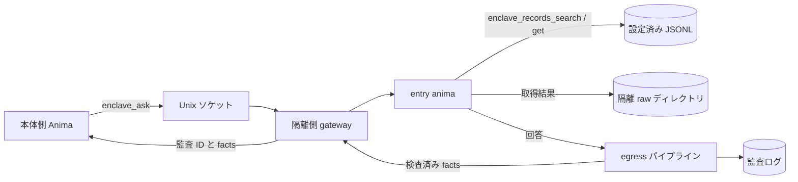

<!-- 自動翻訳ファイル・編集禁止 (AUTO-TRANSLATED, DO NOT EDIT). 正本: docs/ja/enclave.md -->
<!-- i18n: source-sha256=0adbff37775b910578240908d22e4e7e98b9dc8b9b6baac6d5788cba607cc41e generated=2026-10-31 engine=luna model=gpt-6-luna translator=2 -->

> Confirmed commit: f448d7b0

# Building and Operating an Enclave

An enclave is a mechanism that isolates Anima, which handles personal information from SaaS, from the main execution environment. Data references are limited to JSONL files on the isolated side, and communication with the main body is limited to Unix domain sockets. Responses returned to the outside are inspected by the egress pipeline, and you can review the aggregated results and audit records.

## Overview



On the isolated side, `enclave_records_search` and `enclave_records_get` read only configured datasets, save retrieved records and the full text of various tools to `raw_dir`, and return `raw_path`. Search results are stored in `records`, and single-record retrieval results in `record`. The default save location is `ANIMAWORKS_DATA_DIR/raw/YYYYMMDD`, with directory mode `0700` and file mode `0600`. Dataset paths are restricted to `ANIMAWORKS_DATA_DIR`. The host receives no JSONL contents, and the Web UI displays only the connection status and the number of successful and blocked operations for the current day.

## OS Users and Groups

The following is an example for Linux. User, group, and systemd operations are performed with administrator privileges.

```bash
groupadd --system animaworks-enclave
useradd --system --create-home --home-dir /home/aw-enclave \
  --gid animaworks-enclave --shell /usr/sbin/nologin aw-enclave
```

Add the OS user that the main-side service uses to connect to the socket to the group. Replace `<host-user>` with the actual user name of the main-side service.

```bash
HOST_USER=host-service-user  # 本体側サービスの実ユーザー名に置き換える
usermod --append --groups animaworks-enclave "$HOST_USER"
id -u "$HOST_USER"
```

Specify the displayed UID in `allowed_peer_uids` on the isolated side. After adding the group, restart the main-side service to reflect the new supplementary group. The data directory and anima directory on the isolated side must be owned by the execution user and have permissions that prevent other users from reading them. If there is a violation of the startup guard, `doctor` will display the reason.

## Isolated-side configuration

Set `enclave` in the isolated user's `~/.animaworks/config.json`. `datasets.<name>.path` is a path relative to the data directory and specifies the `.jsonl` file. Items not in `searchable_fields` are not included in search.

```json
{
  "enclave": {
    "enabled": true,
    "raw_dir": "raw",
    "name": "saas-data",
    "socket_path": "/run/animaworks-enclave/aw-enclave.sock",
    "socket_group": "animaworks-enclave",
    "entry_anima": "entry-anima",
    "allowed_peer_uids": [1001],
    "allowed_llm_credentials": ["anthropic"],
    "max_concurrency": 2,
    "request_timeout_s": 900,
    "datasets": {
      "customers": {
        "path": "data/customers.jsonl",
        "id_field": "customer_id",
        "searchable_fields": ["customer_id", "name", "kana", "email"]
      },
      "tickets": {
        "path": "data/tickets.jsonl",
        "id_field": "ticket_id",
        "searchable_fields": ["ticket_id", "customer_id", "category", "body"]
      }
    },
    "egress": {
      "stages": [{"type": "masker", "profile": "default"}]
    }
  }
}
```

In `allowed_llm_credentials`, list only the authentication credential names actually used by each isolated anima. `external_tasks.enabled` defaults to `true`, so set it to `false` on the isolated side. The `permissions.json` of a newly created anima has `file_roots` set to `["/"]`, so change it to the necessary scope, such as the anima's own directory (otherwise, the startup guard will refuse to start it). In isolation mode, do not start the Slack, Discord, Zoom, or GitHub Webhook gateways. Other startup guards must also be satisfied, so do not enable event export or external message integrations, and restrict file access to the necessary scope in each anima's `permissions.json`. If restricting external tools for the entry anima, allow `enclave_records`.

To run asks from different threads in parallel up to the gateway's `max_concurrency`, set `chat_max_concurrency` (1–10) in the entry anima's `status.json`, and set it to at least the gateway's `max_concurrency`. When using an SSM tunnel for an SQL source on a fixed port (`tunnel.local_port`), set `tunnel.local_port_count` to match the concurrency. Each process reserves and uses one available port from the consecutive port range starting at `local_port`. Pass that range to the egress firewall's `--loopback-ports` as in `33061-33070`.

Choose the masker's `profile` from `default` and `personal_dates`. `default` replaces all dates with `[MASK-DATE]`. `personal_dates` redacts only dates with headings such as date of birth, dates followed by “born,” dates in Japanese era format, and dates before 2015, while leaving dates such as the time an incident occurred. Use `personal_dates` when returning the results of an investigation into a bug.

For authentication, use password mode in `auth.json` and configure it not to trust localhost. Do not store the password in plaintext; set `password_hash` to the Argon2id hash generated by the application.

```json
{
  "auth_mode": "password",
  "trust_localhost": false,
  "owner": {
    "username": "operator",
    "password_hash": "$argon2id$v=19$m=65536,t=3,p=4$<salt-and-hash>",
    "role": "owner"
  },
  "users": [],
  "sessions": {},
  "token_version": 1,
  "secret_key": ""
}
```

The value of `password_hash` is a format placeholder and should not be used as-is. If you created an authentication user in the Web UI's user settings, retain the generated hash.

## Starting with systemd

`templates/_shared/systemd/animaworks-enclave@.service` is a template that uses `%i` as the execution user name. Replace the virtual environment path and port in `ExecStart` according to the deployment location, and place it in the systemd unit directory with administrator privileges.

```bash
install -m 0644 templates/_shared/systemd/animaworks-enclave@.service \
  /etc/systemd/system/animaworks-enclave@.service
systemctl daemon-reload
systemctl enable --now animaworks-enclave@aw-enclave.service
```

The template sets `User=%i`, a dedicated `RuntimeDirectory`, `UMask=0077`, `NoNewPrivileges=yes`, `PrivateTmp=yes`, and `ProtectSystem=strict`. The write destination is limited to `/home/%i/.animaworks`, and `ProtectHome=tmpfs` and `BindPaths=/home/%i` expose only that user's home directory. The example HTTP port should be a value that does not conflict with the main side. Since the gateway communicates via a Unix socket, the HTTP bind address is limited to loopback.

## Startup on macOS

On macOS, use launchd instead of systemd. Create an OS user and group for isolation, and add the host-side user to the group (the following is an example; use an unused uid below 500).

```bash
dseditgroup -o create -i 299 animaworks-enclave
sysadminctl -addUser _awenclave -UID 299 -GID 299 -shell /usr/bin/false -home /Users/_awenclave
dseditgroup -o edit -a "$HOST_USER" -t user animaworks-enclave
```

Place the socket somewhere that persists across reboots, and set the directory’s ownership to the isolated user and group with `0750` (e.g., `/usr/local/var/animaworks-enclave`). The macOS gateway checks the connecting uid using `LOCAL_PEERCRED`. The way to specify `allowed_peer_uids` is the same as on Linux.

`templates/_shared/launchd/com.animaworks.enclave.plist` is the LaunchDaemon for the isolated instance (`UserName`・`Umask=0077`); `com.animaworks.enclave-egress.plist` is a root LaunchDaemon that applies outbound communication restrictions at startup and every hour. Replace the username, path, and port, place it in `/Library/LaunchDaemons/`, and load it with `launchctl bootstrap system <plist>`. Put secrets in `enclave.secrets_dir` as `0600` files owned by the isolated user, and set the directory to `0700`.

Outbound communication restrictions are implemented with `scripts/enclave/egress_firewall.py --backend pf`. The rules are loaded into the pf anchor `com.apple/250.AnimaworksEnclave` and evaluated from the standard `/etc/pf.conf`, so do not rewrite `pf.conf`. On macOS, pf may exclude `lo0` from evaluation (skip), which means that, as configured, the isolated side can reach loopback services such as host-side APIs. `--apply` removes the skip for `lo0` each time it is applied. The pf `user` setting applies only to TCP and UDP. Copy the script to a root-owned location that neither the host-side nor isolated-side user can modify.

Because launchd has no dependencies between units, specify in the isolated-side configuration’s `enclave.egress_probe` the destinations that should be blocked (the list in `HOST:PORT`). The startup guard attempts a TCP connection to each destination and refuses startup if a connection succeeds. In addition to external destinations, include loopback destinations such as host-side APIs so that a disabled loopback restriction can also be detected. The isolated instance will not run without the restrictions, even if it starts before they are loaded. The same configuration can also be used on Linux.

## Host-Side Connection Configuration

Register the connection destination in the host-side `config.json`. `allowed_animas` is the allow-list of host-side anima instances allowed to call `enclave_ask`. An empty list allows no one.

`allowed_animas` is an application-layer restriction. The OS boundary is enforced by the socket’s group permissions (0660) and the connecting uid, which the gateway checks using `SO_PEERCRED` (`LOCAL_PEERCRED` on macOS) (`allowed_peer_uids`). Any process running under the same uid can connect to the socket. Keep the number of host-side users added to the socket’s group to a minimum.

```json
{
  "enclaves": {
    "saas-data": {
      "socket_path": "/run/animaworks-enclave/aw-enclave.sock",
      "allowed_animas": ["host-assistant"],
      "timeout_s": 900
    }
  }
}
```

If external tools are restricted in the host-side anima’s `permissions.json`, add the module name `enclave` to `external_tools.allow`.

```json
{
  "external_tools": {
    "allow_all": false,
    "allow": ["enclave"],
    "deny": []
  }
}
```

## Inspection and Audit

Run the following on the isolated side. `doctor` checks the startup guards, socket types, modes, and groups, gateway `/v1/health`, egress pipeline configuration, and imports of `fugashi` and `ipadic`. If `enclaves` is configured on the main side, it also checks each socket's connection and health response. On problems, it exits with code 1; with `--json`, it returns machine-readable results.

```bash
animaworks enclave doctor
animaworks enclave doctor --json
animaworks enclave status
```

`status` outputs only the number of successful and blocked operations for the current day and does not display the contents of questions or answers. The egress audit log is saved to `~/.animaworks/enclave/audit/egress/YYYYMMDD.jsonl`, and the full text of retrieved results to `~/.animaworks/raw/YYYYMMDD/`. Because the audit log and raw files contain the facts and raw data being processed, maintain access permissions and do not copy them outside the isolated environment.

## Connecting to Real Data Sources

From the isolated side, you can reference a production MySQL-compatible DB in read-only mode. The connection cannot be written with real examples of the data handled (since this is a public repository, do not write customer names, industries, real host names, IPs, or account IDs). Everything below is a placeholder using `example`.

### Where to Store Secrets

Pass the DB password, AWS access key, and Laravel APP_KEY only to the isolated process through `enclave.secrets_dir` or systemd's `LoadCredential=`. Secret files should be root-owned and have mode `0600`. Do not write secret values in plaintext in configuration files. Put one key per line in the Laravel APP_KEY file, with the current key first and old keys on subsequent lines.

- When using systemd: use `LoadCredential=` in `animaworks-enclave@.service` to load `/etc/credstore/animaworks-enclave/<name>/db-password` and other secrets, making them readable from `$CREDENTIALS_DIRECTORY`.
- If you specify a different directory for `enclave.secrets_dir`, use the same format and place each value in a file named after the secret.

```bash
install -m 0600 -o root -g root db-password /etc/credstore/animaworks-enclave/aw-enclave/db-password
install -m 0600 -o root -g root aws-creds  /etc/credstore/animaworks-enclave/aw-enclave/aws-creds
```

### sql_sources Configuration Example

Define a read-only data source in `enclave.sql_sources`. `password_secret` is the secret name. If you set `tunnel`, it connects to RDS through SSM Session Manager port forwarding (via a bastion host). The contents of `aws_secret` are JSON in the `{"aws_access_key_id": "...", "aws_secret_access_key": "..."}` format.

```json
{
  "enclave": {
    "enabled": true,
    "secrets_dir": null,
    "sql_sources": {
      "main-db": {
        "driver": "mysql",
        "host": "example.rds.example.amazonaws.com",
        "port": 3306,
        "database": "example_db",
        "user": "enclave_reader",
        "password_secret": "db-password",
        "ssl": true,
        "max_rows": 200,
        "timeout_s": 30,
        "cell_max_chars": 2000,
        "app_key_secret": "laravel-app-keys",
        "decrypt_columns": ["^request$", "^body$", "^title$"],
        "tunnel": {
          "type": "ssm_port_forward",
          "region": "example-region-1",
          "target_tag_name": "example-bastion-tag",
          "aws_secret": "aws-creds",
          "plugin_path": "/usr/local/bin/session-manager-plugin",
          "idle_shutdown_s": 600
        }
      }
    }
  }
}
```

`app_key_secret` is the name of the secret file that stores Laravel APP_KEY values, one key per line. It handles `base64:` format and UTF-8 keys, trying the first line as the current key and subsequent lines as old keys. `decrypt_columns` is a regular expression used to match result column names (after aliases are applied) with `re.search`. For string cells in matching columns, it attempts decryption in Laravel AES-256-CBC format; values that cannot be decrypted are returned unchanged. SQL result rows are saved to a raw file after decryption and before cell truncation, and the full text can be read from `raw_path` in the tool result. SSL is required by default. If using an RDS CA, set `ssl_ca` to the CA path. If host name verification must be disabled, consider that the host name will not match through the tunnel, and leave `ssl_verify_identity: false` at its default value.

### Reading the doctor

Setting `sql_sources` adds an inspection of each source to `animaworks enclave doctor`. The startup guard does not stop startup even if secrets are not yet placed; the doctor displays `fail` (for operations where secrets can be placed later).

- `<name>.secrets`: Whether the secret files of `password_secret` and `tunnel.aws_secret` can be read.
- `<name>.plugin`: Whether `session-manager-plugin` is executable.
- `<name>.deps`: Whether `pymysql` and `boto3` can be imported.

It does not connect to the actual DB or AWS.

## AWS Read-Only Sources

Register CloudWatch Logs, RDS Performance Insights, RDS log files, and S3 read targets in `enclave.aws_sources`. Credentials are loaded from the secret file specified in `aws_secret`; AWS keys are not included in configuration files or tool output. All names and values below are explanatory placeholders.

```json
{
  "enclave": {
    "enabled": true,
    "secrets_dir": null,
    "aws_sources": {
      "observability": {
        "region": "example-region-1",
        "aws_secret": "aws-readonly",
        "log_groups": ["/example/application/*"],
        "pi_resource_id": "db-example-resource",
        "rds_instance_id": "db-example-instance",
        "s3_buckets": ["example-placeholder-bucket"],
        "max_bytes": 200000
      }
    }
  }
}
```

Set the contents of the secret `aws-readonly` file to the following JSON format. The values are illustrative placeholders; do not use them as-is.

```json
{"aws_access_key_id":"<access-key>","aws_secret_access_key":"<secret-key>"}
```

`log_groups` permits exact matches or prefix matches using a trailing `*`. The PI and RDS tools each use only their configured resource IDs, and S3 accesses only the buckets listed in `s3_buckets`. Times can be specified in ISO8601 or relative `-1h` / `-24h` format. Logs Insights queries are polled for up to 60 seconds, and the text returned by each tool is limited by `max_bytes`. AWS tools save the full text and records before truncation to `raw_dir`, which can be read from `raw_path` in the result. For non-text S3 objects or objects exceeding the limit, the contents are not included in the tool response; they are also saved to the existing `enclave/downloads/<bucket>/<key-sha256>` with mode `0600`.

The AWS source `doctor` check verifies `aws_sources.<name>.secret` and `.deps` (`boto3`). It does not connect to AWS; it only checks that the secret exists and that the SDK can be imported.

## Verifying Operation with Mock Data

The mock data generation script uses a fixed seed to regenerate the same 100 customer records and 300 inquiry tickets. Some tickets include names and phone numbers in their text. Do not use real data, and place the output in the isolated side’s data directory.

```bash
DATA_DIR="$HOME/.animaworks"
uv run python scripts/enclave/make_mock_dataset.py --out "$DATA_DIR/data"
```

Confirm that `datasets` in the isolated side’s config points to the `data/customers.jsonl` and `data/tickets.jsonl` above, and allow the entry anima to use `enclave_records_search` and `enclave_records_get`. Then do the following:

1. On the isolated side, run `animaworks enclave doctor` and check the status of the guard and gateway.
2. Register the destination in `config.json` on the main side, and allow the main-side anima to use `enclave`.
3. Run `animaworks-tool enclave ask --enclave saas-data --question "問い合わせをカテゴリ別に要約して"` from the main side. Use the `job_id` returned immediately to check the status with `animaworks-tool enclave status --enclave saas-data --job-id <job_id>`. The completion result will arrive in the caller’s inbox. If needed, cancel it with `animaworks-tool enclave cancel --enclave saas-data --job-id <job_id>`.
4. On the isolated side, run `animaworks enclave status` and confirm that the number of successes has increased. The Web UI home screen displays only the connection status and aggregate counts.
