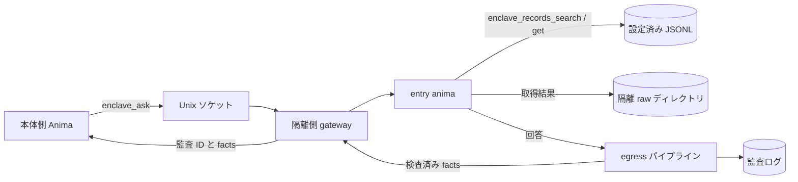

<!-- 自動翻訳ファイル・編集禁止 (AUTO-TRANSLATED, DO NOT EDIT). 正本: docs/ja/enclave.md -->
<!-- i18n: source-sha256=678562bed397eb607cfd7411f78b5329891e01edb8430af39e68a87ea6b131a4 generated=2026-10-31 engine=luna model=gpt-6-luna translator=2 -->

> 확인한 커밋: f448d7b0

# Enclave 구축 및 운영

Enclave는 SaaS의 개인 정보 등을 다루는 Anima를 본체의 실행 환경에서 분리하는 메커니즘이다. 데이터 참조는 격리 측의 JSONL 파일로 제한하고, 본체와의 통신은 Unix 도메인 소켓으로 제한한다. 외부로 반환하는 답변은 egress 파이프라인에서 검사하며, 결과 집계와 감사 기록을 확인할 수 있다.

## 개요



격리 측의 `enclave_records_search` 및 `enclave_records_get`는 설정된 데이터셋만 읽고, 검색한 레코드와 각종 도구의 전체 내용을 `raw_dir`에 저장한 뒤 `raw_path`를 반환한다. 검색 결과는 `records`에, 단건 조회 결과는 `record`에 저장된다. 저장 위치는 기본적으로 `ANIMAWORKS_DATA_DIR/raw/YYYYMMDD`이며, 디렉터리 mode는 `0700`, 파일 mode는 `0600`이다. 데이터셋 경로는 `ANIMAWORKS_DATA_DIR` 내부로 제한된다. 호스트 측에는 JSONL 본문을 반환하지 않으며, Web UI에는 연결 상태와 당일 성공·차단 건수만 표시한다.

## OS 사용자 및 그룹

다음은 Linux에서의 예시다. 사용자·그룹 및 systemd 작업은 관리자 권한으로 수행한다.

```bash
groupadd --system animaworks-enclave
useradd --system --create-home --home-dir /home/aw-enclave \
  --gid animaworks-enclave --shell /usr/sbin/nologin aw-enclave
```

본체 측 서비스가 소켓에 연결하는 OS 사용자를 그룹에 추가한다. `<host-user>`는 본체 측 서비스의 실제 사용자 이름으로 바꾼다.

```bash
HOST_USER=host-service-user  # 本体側サービスの実ユーザー名に置き換える
usermod --append --groups animaworks-enclave "$HOST_USER"
id -u "$HOST_USER"
```

표시된 UID를 격리 측의 `allowed_peer_uids`로 지정한다. 그룹을 추가한 뒤에는 본체 측 서비스를 다시 시작해 새 보조 그룹을 반영한다. 격리 측 데이터 디렉터리와 anima 디렉터리는 실행 사용자가 소유하게 하고, 다른 사용자가 읽을 수 없도록 권한을 설정한다. 시작 시 가드를 위반하면 `doctor`에 이유가 표시된다.

## 격리 측 설정

격리 사용자의 `~/.animaworks/config.json`에 `enclave`을 설정한다. `datasets.<name>.path`는 data directory 기준 상대 경로이며, `.jsonl` 파일을 지정한다. `searchable_fields`에 없는 항목은 검색 대상이 되지 않는다.

```json
{
  "enclave": {
    "enabled": true,
    "raw_dir": "raw",
    "name": "saas-data",
    "socket_path": "/run/animaworks-enclave/aw-enclave.sock",
    "socket_group": "animaworks-enclave",
    "entry_anima": "entry-anima",
    "allowed_peer_uids": [1001],
    "allowed_llm_credentials": ["anthropic"],
    "max_concurrency": 2,
    "request_timeout_s": 900,
    "datasets": {
      "customers": {
        "path": "data/customers.jsonl",
        "id_field": "customer_id",
        "searchable_fields": ["customer_id", "name", "kana", "email"]
      },
      "tickets": {
        "path": "data/tickets.jsonl",
        "id_field": "ticket_id",
        "searchable_fields": ["ticket_id", "customer_id", "category", "body"]
      }
    },
    "egress": {
      "stages": [{"type": "masker", "profile": "default"}]
    }
  }
}
```

`allowed_llm_credentials`에는 격리 측의 각 anima가 실제로 사용하는 인증 정보 이름만 나열한다. `external_tasks.enabled`은 초기값이 `true`이므로, 격리 측에서는 `false`으로 설정한다. 새로 만든 anima의 `permissions.json`은 `file_roots`가 `["/"]`으로 되어 있으므로, anima 자체의 디렉터리 등 필요한 범위로 수정한다(그대로 두면 시작 시 가드가 시작을 거부한다). 격리 모드에서는 Slack·Discord·Zoom·GitHub Webhook 게이트웨이를 시작하지 않는다. 다른 시작 시 가드도 충족해야 하므로 이벤트 내보내기나 외부 메시지 연동을 활성화하지 말고, 각 anima의 `permissions.json`에서 파일 접근을 필요한 범위로 제한한다. entry anima의 외부 도구를 제한할 경우 `enclave_records`를 허용한다.

서로 다른 thread의 ask를 gateway의 `max_concurrency`까지 병렬 실행하려면, entry anima의 `status.json`에 `chat_max_concurrency`(1~10)을 설정하고 gateway의 `max_concurrency` 이상으로 설정한다. SQL 소스의 SSM 터널을 고정 포트(`tunnel.local_port`)로 사용하는 경우에는 `tunnel.local_port_count`을 동시 실행 수에 맞춘다. 각 프로세스는 `local_port`에서 시작하는 연속 포트 중 비어 있는 포트 하나를 예약해 사용한다. egress firewall의 `--loopback-ports`에는 해당 범위를 `33061-33070`와 같이 전달한다.

masker의 `profile`는 `default`과 `personal_dates` 중에서 선택한다. `default`은 모든 날짜를 `[MASK-DATE]`로 바꾼다. `personal_dates`은 생년월일과 같은 제목이 붙은 날짜, ‘출생’이 뒤따르는 날짜, 일본 연호 날짜, 2015년 이전 날짜만 가리고, 장애 발생 시각과 같은 날짜는 남긴다. 버그 조사 결과를 반환하는 용도라면 `personal_dates`을 사용한다.

인증에는 `auth.json`의 password 모드를 사용하고, localhost를 신뢰하지 않도록 설정한다. 비밀번호의 평문은 저장하지 말고, `password_hash`에는 애플리케이션이 생성한 Argon2id 해시를 설정한다.

```json
{
  "auth_mode": "password",
  "trust_localhost": false,
  "owner": {
    "username": "operator",
    "password_hash": "$argon2id$v=19$m=65536,t=3,p=4$<salt-and-hash>",
    "role": "owner"
  },
  "users": [],
  "sessions": {},
  "token_version": 1,
  "secret_key": ""
}
```

`password_hash`의 값은 형식을 나타내는 플레이스홀더이므로 그대로 사용하지 않는다. 인증 사용자를 Web UI의 사용자 설정에서 만들었다면 생성된 해시를 유지한다.

## systemd로 시작하기

`templates/_shared/systemd/animaworks-enclave@.service`은 `%i`를 실행 사용자 이름으로 사용하는 템플릿이다. `ExecStart`의 가상 환경 경로와 포트를 배포 위치에 맞게 바꾼 뒤, 관리자 권한으로 systemd unit 디렉터리에 배치한다.

```bash
install -m 0644 templates/_shared/systemd/animaworks-enclave@.service \
  /etc/systemd/system/animaworks-enclave@.service
systemctl daemon-reload
systemctl enable --now animaworks-enclave@aw-enclave.service
```

템플릿은 `User=%i`, 전용 `RuntimeDirectory`, `UMask=0077`, `NoNewPrivileges=yes`, `PrivateTmp=yes`, `ProtectSystem=strict`를 설정한다. 쓰기 대상은 `/home/%i/.animaworks`만 허용하고, `ProtectHome=tmpfs` 및 `BindPaths=/home/%i`를 통해 해당 사용자의 home만 공개한다. 예시의 HTTP 포트는 본체 측과 충돌하지 않는 값으로 설정한다. gateway는 Unix 소켓으로 통신하므로 HTTP bind address는 loopback으로 제한한다.

## macOS에서 시작

macOS에서는 systemd 대신 launchd를 사용한다. 격리용 OS 사용자와 그룹을 만들고, 본체 측 사용자를 그룹에 추가한다(아래는 예시이며 uid는 500 미만의 빈 번호를 사용한다).

```bash
dseditgroup -o create -i 299 animaworks-enclave
sysadminctl -addUser _awenclave -UID 299 -GID 299 -shell /usr/bin/false -home /Users/_awenclave
dseditgroup -o edit -a "$HOST_USER" -t user animaworks-enclave
```

소켓은 재시작해도 사라지지 않는 위치에 두고 디렉터리를 격리 사용자와 그룹의 `0750`로 설정한다(예: `/usr/local/var/animaworks-enclave`). macOS의 gateway는 연결을 시작한 uid를 `LOCAL_PEERCRED`로 확인한다. `allowed_peer_uids`를 지정하는 방법은 Linux와 동일하다.

`templates/_shared/launchd/com.animaworks.enclave.plist`는 격리 인스턴스의 LaunchDaemon(`UserName`·`Umask=0077`)이고, `com.animaworks.enclave-egress.plist`은 외부 통신 제한을 시작 시와 매시간 적용하는 root의 LaunchDaemon이다. 사용자 이름·경로·포트를 바꿔 `/Library/LaunchDaemons/`에 두고, `launchctl bootstrap system <plist>`으로 불러온다. 비밀 정보는 `enclave.secrets_dir`에 격리 사용자 소유의 `0600` 파일로 두고, 디렉터리를 `0700`로 설정한다.

외부 통신 제한은 `scripts/enclave/egress_firewall.py --backend pf`로 적용한다. 규칙은 pf 앵커 `com.apple/250.AnimaworksEnclave`에 불러오며 기본 `/etc/pf.conf`에서 평가되므로 `pf.conf`은 수정하지 않는다. pf의 `user` 지정은 TCP와 UDP에만 적용된다. 스크립트는 본체 측 사용자와 격리 측 사용자 모두 수정할 수 없는 root 소유 위치에 복사해 사용한다.

launchd에는 unit 간 종속성이 없으므로 격리 측 config의 `enclave.egress_probe`에 차단해야 할 대상(`HOST:PORT` 목록)을 지정한다. 시작 시 가드는 각 대상에 TCP 연결을 시도하고, 연결되면 시작을 거부한다. 제한이 불러와지기 전에 시작하더라도 제한이 없으면 작동하지 않는다. Linux에서도 같은 설정을 사용할 수 있다.

## 본체 측 연결 설정

본체 측 `config.json`에 연결 대상을 등록한다. `allowed_animas`은 `enclave_ask`를 호출할 수 있는 본체 측 anima의 허용 목록이다. 목록이 비어 있으면 아무도 허용하지 않는다.

`allowed_animas`은 애플리케이션 계층의 제한이다. OS 경계는 소켓의 그룹 권한(0660)과 gateway가 `SO_PEERCRED`(macOS에서는 `LOCAL_PEERCRED`)로 확인하는 연결 시작 uid(`allowed_peer_uids`)로 구성된다. 같은 uid의 프로세스라면 어느 것이든 소켓에 연결할 수 있다. 본체 측에서 소켓 그룹에 포함하는 사용자는 최소한으로 제한한다.

```json
{
  "enclaves": {
    "saas-data": {
      "socket_path": "/run/animaworks-enclave/aw-enclave.sock",
      "allowed_animas": ["host-assistant"],
      "timeout_s": 900
    }
  }
}
```

본체 측 anima의 `permissions.json`에서 외부 도구를 제한하는 경우, `external_tools.allow`에 모듈 이름 `enclave`을 추가한다.

```json
{
  "external_tools": {
    "allow_all": false,
    "allow": ["enclave"],
    "deny": []
  }
}
```

## 점검 및 감사

격리 측에서 다음을 실행한다. `doctor`은 시작 시 가드, 소켓의 종류·mode·그룹, gateway의 `/v1/health`, egress 파이프라인 설정, `fugashi` 및 `ipadic`의 import를 확인한다. 본체 측에서 `enclaves`를 설정한 경우에는 각 소켓의 연결과 health 응답도 확인한다. 문제가 있으면 exit code 1이 되고, `--json`에서는 기계 판독 가능한 결과를 반환한다.

```bash
animaworks enclave doctor
animaworks enclave doctor --json
animaworks enclave status
```

`status`은 당일 성공·차단 건수만 출력하며, 질문이나 답변의 본문은 표시하지 않는다. egress 감사 로그는 `~/.animaworks/enclave/audit/egress/YYYYMMDD.jsonl`에, 검색 결과 전체 내용은 `~/.animaworks/raw/YYYYMMDD/`에 저장된다. 감사 로그와 raw 파일에는 처리 대상인 facts나 원시 데이터가 포함되므로 액세스 권한을 유지하고 격리 환경 밖으로 복사하지 않는다.

## 실제 데이터 소스 연결

격리 측에서 운영 MySQL 호환 DB를 읽기 전용으로 참조할 수 있습니다. 연결은 다루는 데이터를 실제 예시로 작성할 수 없습니다(공개 리포지토리이므로 고객명·업종·실제 호스트명·IP·계정 ID는 작성하지 마세요). 아래는 모두 `example`을 사용한 플레이스홀더입니다.

### 비밀 정보 배치 방법

DB 비밀번호, AWS 액세스 키, Laravel APP_KEY는 `enclave.secrets_dir` 또는 systemd의 `LoadCredential=`를 통해 격리 프로세스에만 전달한다. 비밀 파일은 root 소유로 하고 mode를 `0600`으로 설정한다. 비밀 값을 설정 파일에 평문으로 작성해서는 안 된다. Laravel APP_KEY 파일은 한 줄에 하나의 키를 넣고, 현재 키를 첫 줄에, 이전 키를 그 다음 줄부터 배치한다.

- systemd를 사용하는 경우: `animaworks-enclave@.service`의 `LoadCredential=`에서 `/etc/credstore/animaworks-enclave/<name>/db-password` 등을 불러오고, `$CREDENTIALS_DIRECTORY`에서 읽을 수 있도록 한다.
- 다른 디렉터리를 `enclave.secrets_dir`로 지정한 경우에도 같은 형식으로, 이름을 파일명으로 사용해 값을 배치한다.

```bash
install -m 0600 -o root -g root db-password /etc/credstore/animaworks-enclave/aw-enclave/db-password
install -m 0600 -o root -g root aws-creds  /etc/credstore/animaworks-enclave/aw-enclave/aws-creds
```

### sql_sources 설정 예시

`enclave.sql_sources`에 읽기 전용 데이터 소스를 정의한다. `password_secret`는 비밀 정보의 이름이다. `tunnel`을 설정하면 SSM Session Manager의 포트 포워딩(배스천 경유)으로 RDS에 연결한다. `aws_secret`의 내용은 `{"aws_access_key_id": "...", "aws_secret_access_key": "..."}`의 JSON이다.

```json
{
  "enclave": {
    "enabled": true,
    "secrets_dir": null,
    "sql_sources": {
      "main-db": {
        "driver": "mysql",
        "host": "example.rds.example.amazonaws.com",
        "port": 3306,
        "database": "example_db",
        "user": "enclave_reader",
        "password_secret": "db-password",
        "ssl": true,
        "max_rows": 200,
        "timeout_s": 30,
        "cell_max_chars": 2000,
        "app_key_secret": "laravel-app-keys",
        "decrypt_columns": ["^request$", "^body$", "^title$"],
        "tunnel": {
          "type": "ssm_port_forward",
          "region": "example-region-1",
          "target_tag_name": "example-bastion-tag",
          "aws_secret": "aws-creds",
          "plugin_path": "/usr/local/bin/session-manager-plugin",
          "idle_shutdown_s": 600
        }
      }
    }
  }
}
```

`app_key_secret`은 Laravel의 APP_KEY를 한 줄에 하나씩 저장한 비밀 파일 이름이다. `base64:` 형식과 UTF-8 키를 처리하며, 첫 줄을 현재 키로, 그 다음 줄부터 이전 키로 사용해 복호화를 시도한다. `decrypt_columns`은 결과 열 이름(alias 적용 후)을 `re.search`로 대조하는 정규식이다. 해당 열의 문자열 셀은 Laravel AES-256-CBC 형식으로 복호화를 시도하며, 복호화할 수 없는 값은 그대로 반환한다. SQL 조회 행은 복호화 후, 셀을 자르기 전에 raw 파일에 저장되며 도구 결과의 `raw_path`에서 전체 내용을 Read할 수 있다. SSL은 기본적으로 필수다. RDS CA를 사용하는 경우 `ssl_ca`에 CA 경로를 지정한다. 호스트 이름 검증을 비활성화해야 한다면 `ssl_verify_identity: false`(기본값)을 그대로 두되, 터널을 경유하기 때문에 호스트 이름이 일치하지 않는 점을 고려한다.

### doctor 보는 방법

`sql_sources`을 설정하면 `animaworks enclave doctor`에 각 소스의 검사가 추가됩니다. 시작 시 가드는 비밀값이 미배치되어도 시작을 막지 않고, doctor에서 `fail`를 표시합니다(비밀값은 나중에 배치할 수 있는 운영 방식).

- `<name>.secrets`: `password_secret`와 `tunnel.aws_secret`의 비밀 파일을 읽을 수 있는지.
- `<name>.plugin`: `session-manager-plugin`이 실행 가능한지.
- `<name>.deps`: `pymysql`와 `boto3`을 import 할 수 있는지.

실제 DB·AWS에는 연결하지 않습니다.

## AWS 읽기 전용 소스

`enclave.aws_sources`에는 CloudWatch Logs, RDS Performance Insights, RDS 로그 파일, S3의 읽기 대상을 등록한다. 인증 정보는 `aws_secret`에서 지정한 비밀 파일에서 읽으며, 설정 파일이나 도구 출력에 AWS 키를 포함하지 않는다. 아래 이름과 값은 모두 설명용 플레이스홀더다.

```json
{
  "enclave": {
    "enabled": true,
    "secrets_dir": null,
    "aws_sources": {
      "observability": {
        "region": "example-region-1",
        "aws_secret": "aws-readonly",
        "log_groups": ["/example/application/*"],
        "pi_resource_id": "db-example-resource",
        "rds_instance_id": "db-example-instance",
        "s3_buckets": ["example-placeholder-bucket"],
        "max_bytes": 200000
      }
    }
  }
}
```

비밀 정보 `aws-readonly`의 파일 내용은 다음 JSON 형식으로 작성한다. 값은 예시용 플레이스홀더이므로 그대로 사용하지 않는다.

```json
{"aws_access_key_id":"<access-key>","aws_secret_access_key":"<secret-key>"}
```

`log_groups`은 완전 일치 또는 끝의 `*`을 사용한 접두사 일치로 허용한다. PI·RDS 도구는 각각 설정된 리소스 ID만 사용하고, S3는 `s3_buckets`에 나열된 버킷에만 액세스한다. 시간은 ISO8601 또는 `-1h` / `-24h` 형식의 상대 지정이다. Logs Insights 쿼리는 최대 60초 동안 폴링하며, 각 도구의 반환 텍스트는 `max_bytes`으로 제한된다. AWS 도구는 자르기 전의 전체 내용·레코드를 `raw_dir`에 저장하며, 결과의 `raw_path`에서 읽을 수 있다. 텍스트가 아니거나 상한을 초과하는 S3 객체는 본문을 도구 응답에 포함하지 않고 기존 `enclave/downloads/<bucket>/<key-sha256>`에도 mode `0600`로 저장한다.

AWS 소스의 `doctor` 검사는 `aws_sources.<name>.secret` 및 `.deps`(`boto3`)을 확인한다. 실제 AWS에 연결하지 않고 비밀 정보의 존재와 SDK를 import할 수 있는지만 검사한다.

## 모의 데이터로 동작 확인

모의 데이터 생성 스크립트는 고정 시드를 사용해 동일한 고객 데이터 100건과 문의 티켓 300건을 다시 생성한다. 이름이나 전화번호가 본문에 포함된 티켓도 있다. 실제 데이터는 사용하지 않고, 출력 대상은 격리된 쪽의 데이터 디렉터리 안으로 한다.

```bash
DATA_DIR="$HOME/.animaworks"
uv run python scripts/enclave/make_mock_dataset.py --out "$DATA_DIR/data"
```

격리된 쪽 config의 `datasets`이 위의 `data/customers.jsonl`와 `data/tickets.jsonl`을 가리키는지 확인하고, entry anima가 `enclave_records_search`와 `enclave_records_get`를 이용할 수 있도록 한다. 이어서 다음을 수행한다.

1. 격리된 쪽에서 `animaworks enclave doctor`을 실행하고 가드와 게이트웨이의 상태를 확인한다.
2. 본체 쪽의 `config.json`에 접속 대상을 등록하고, 본체 쪽 anima에 `enclave`을 허용한다.
3. 본체 쪽에서 `animaworks-tool enclave ask --enclave saas-data --question "問い合わせをカテゴリ別に要約して"`를 실행한다. 즉시 반환되는 `job_id`을 사용해 `animaworks-tool enclave status --enclave saas-data --job-id <job_id>`에서 상태를 확인한다. 완료 결과는 호출자의 inbox에 도착한다. 필요하다면 `animaworks-tool enclave cancel --enclave saas-data --job-id <job_id>`로 취소한다.
4. 격리된 쪽에서 `animaworks enclave status`을 실행하고 성공 건수가 늘어난 것을 확인한다. 웹 UI 홈 화면에는 연결 상태와 집계 건수만 표시된다.
